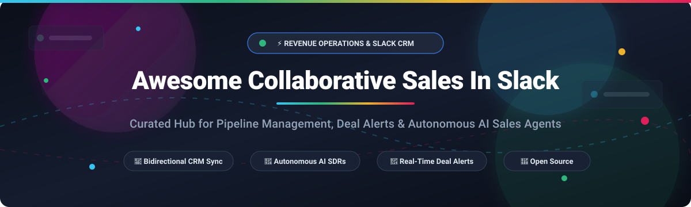

# Awesome Collaborative Sales In Slack 🚀

  

  
  
  
  
  
  
  

---

## 🎯 Top Collaborative Sales In Slack Ecosystem

> **A curated collection of SaaS platforms, AI sales agents, and open-source tools for pipeline management, deal collaboration, CRM bi-directional sync, and sales workflow automation directly inside Slack.**

*Keywords: collaborative sales, slack crm, salesforce slack integration, hubspot slack, revenue intelligence, sales engagement, pipeline management, ai sales agents, revops automation, salesloft, gong, deal alerts, open-source crm.*

---

## 📑 Table of Contents

- [📊 Sector Overview & Market Dynamics](#-sector-overview--market-dynamics)
- [☁️ SaaS & Hosted Platforms](#️-saas--hosted-platforms)
- [💻 Open-Source GitHub Projects](#-open-source-github-projects)
- [📈 Star History](#-star-history)
- [💖 Support](#-support)
- [🤝 How to Contribute](#-how-to-contribute)
- [⚠️ Disclaimer](#️-disclaimer)

---

## 📊 Sector Overview & Market Dynamics

The collaborative sales and revenue intelligence sector is estimated at **$3.8B–$4.0B in 2024–2025 and projected to surpass $10B+ by 2034**, driven by real-time conversational deal orchestration inside workspaces like Slack. 

The market is **moderately fragmented and consolidating rapidly**, transitioning from standalone workflow alert bots into a concentrated, high-tier competition dominated by CRM titans (Salesforce, HubSpot) and AI-first revenue orchestration platforms (Clari, Gong, Salesloft).

---

## ☁️ SaaS & Hosted Platforms

| 🏢 Product | 📈 Company Size (Revenue / Valuation) | 💵 Pricing (Starting Tier) | 🎁 Free Tier Limits | 📝 Description |
| :--- | :--- | :--- | :--- | :--- |
| **[Salesforce Slack Sales Elevate](https://www.salesforce.com/slack/)** | ~$38B Revenue / ~$290B Market Cap | $60 / user / month (requires Slack Business+ at $15/user/mo and Sales Cloud) | 30-day free trial (full Sales Cloud & Slack integration test environment) | Native Slack integration bringing Salesforce CRM data, deal alerts, and pipeline management directly into Slack. Includes Agentforce Sales AI agents. |
| **[HubSpot for Slack](https://www.hubspot.com/)** | ~$2.6B Revenue / ~$30B Market Cap | $15 / user / month (Sales Hub Starter, billed annually) | Free forever plan: capped at 2 users, 1,000 contacts, 1 deal pipeline, and 2,000 marketing emails/month | CRM notifications, deal updates, and contact management within Slack with lead capture and bidirectional sync. |
| **[Gong for Slack](https://www.gong.io/)** | ~$250M+ ARR / ~$7.2B Valuation | $1,200–$1,400 / user / year (~$100–$120/mo per user) + base platform fee (~$5,000/yr) | No self-serve free trial; custom sandbox evaluation provided only via guided sales demo | Revenue intelligence platform with Slack integration for deal alerts, conversational call insights, and pipeline collaboration. |
| **[Workbot for Slack](https://www.workato.com/)** | ~$150M+ ARR / ~$5.7B Valuation | $75 / month (Workato Pro credit tier; enterprise platform starts at ~$10,000/year) | Free community account: includes 100 free automation task credits, no time limit; enterprise trial requires sales-assisted sandbox | Workato's enterprise Slack bot enabling no-code automation and deal actions between Slack and 400+ CRM and ERP apps. |
| **[Clari for Slack](https://www.clari.com/)** | ~$100M+ ARR / ~$2.6B Valuation | ~$100 / user / month ($1,200/user/year, billed annually) | No self-serve free trial; pilot evaluation available through enterprise proof-of-concept / guided demo | Revenue operations platform bringing forecast updates, pipeline alerts, and deal risk notifications into Slack channels. |
| **[Salesloft for Slack](https://salesloft.com/)** | ~$150M+ ARR / ~$2.3B Valuation | ~$125 / user / month (Advanced package, billed annually) | No self-serve free trial; pilot sandbox access provided upon enterprise sales qualification | Sales engagement platform integration with Slack for cadence notifications, deal alerts, and team prospect outreach. |
| **[Scratchpad](https://scratchpad.com/)** | ~$10M–$20M ARR / ~$300M Valuation | $29 / user / month (Solo plan, billed annually) | Free forever plan: 100 AI credits/user/month, 3 AI sales sheets, call transcripts, unlimited sales notes; 30-day full-feature trial | Fast Salesforce update and sales workflow platform in Slack with stale opportunity alerts and pipeline hygiene reminders. |
| **[Troops.ai / Slack Sales Elevate](https://www.salesforce.com/slack/)** | Acquired by Salesforce for ~$100M (2022) | $60 / user / month (folded into Salesforce Slack Sales Elevate) | No standalone trial; accessible via Salesforce Sales Elevate 30-day trial | Pioneer in Slack sales alerts; enables CRM search/edit and alert workflows inside Slack. Fully unified into Slack Sales Elevate. |
| **[Aviso for Slack](https://aviso.com/)** | ~$10M–$20M ARR / ~$80M Valuation | ~$50 / user / month ($600/user/year entry tier, custom enterprise contracts) | No self-serve free trial; personalized demo and qualified pilot access on request | AI-powered sales forecasting and pipeline management with Slack notifications for deal risks and forecast changes. |
| **[Floworks](https://www.ycombinator.com/launches/ICx-floworks-close-more-deals-with-crm-on-slack)** | ~$1M–$3M ARR / ~$15M–$25M Valuation (YC S23) | $498 / month (Ultra plan) | 7-day free trial on Ultra plan (test AI SDR reachout and CRM sync without credit card) | YC-backed CRM-on-Slack solution integrating Salesforce, HubSpot, and Pipedrive with Slack for bidirectional deal updates and notes. |

---

## 💻 Open-Source GitHub Projects

Curated open-source projects, autonomous AI sales agents, extensible CRMs, and developer toolkits with Slack integrations, sorted by GitHub stars:

| 📦 Repository | ⭐ Stars | 📝 Description |
| :--- | :--- | :--- |
| **[OpenClaw](https://github.com/openclaw/openclaw)** |  | Open-source AI gateway (MIT) connecting LLMs to Slack, WhatsApp, and Telegram with built-in memory and scheduling to build AI sales agents that monitor pipelines and dispatch deal alerts. |
| **[n8n](https://github.com/n8n-io/n8n)** |  | Open-source workflow automation platform with extensive community templates for Slack + CRM bidirectional synchronization, natural language CRM queries, and pipeline stall detection. |
| **[Twenty](https://github.com/twentyhq/twenty)** |  | Modern open-source CRM (AGPL-3.0) built as a Salesforce alternative. Features customizable data models, Kanban views, workflow automation, and native Slack integration. |
| **[Cal.com](https://github.com/calcom/cal.com)** |  | Open-source scheduling infrastructure (AGPLv3) featuring Slack app integration to automate sales demo bookings, round-robin meeting routing, and deal qualification notifications. |
| **[Chatwoot](https://github.com/chatwoot/chatwoot)** |  | Open-source customer engagement suite with Slack integration to manage live prospect conversations and inbound sales qualification directly from Slack. |
| **[Activepieces](https://github.com/activepieces/activepieces)** |  | Open-source no-code business automation tool (MIT) providing out-of-the-box Slack, HubSpot, Salesforce, and Pipedrive connectors for sales alert flows. |
| **[Krayin CRM](https://github.com/krayin/laravel-crm)** |  | Laravel-based open-source CRM with pipeline management, lead routing, and extensible REST APIs for Slack webhooks and sales bots. |
| **[Comp AI CRM](https://github.com/trycompai/crm)** |  | Open-source CRM built around autonomous agents that scan team inboxes, enrich contacts, schedule follow-ups, and ping Slack channels on deal events. |
| **[SuiteCRM](https://github.com/salesagility/SuiteCRM)** |  | Enterprise-grade open-source CRM for sales, service, and marketing operations with webhook and REST API capabilities for Slack notifications. |
| **[Frappe CRM](https://github.com/frappe/crm)** |  | Modern open-source CRM for leads, contacts, pipelines, and account workflows built on Frappe Framework with native webhook support for Slack notifications. |
| **[EspoCRM](https://github.com/espocrm/espocrm)** |  | Open-source web-based CRM for managing accounts, deals, and automated workflows, featuring comprehensive REST APIs for Slack bots. |
| **[MemMachine CRM Agent](https://github.com/MemMachine/MemMachine)** |  | Open-source CRM agent with Slack integration, featuring conversational memory, real-time message processing, and AI-powered pipeline queries. |
| **[Slack Bolt (JS)](https://github.com/slackapi/bolt-js)** |  | Official JavaScript framework for building collaborative Slack apps, interactive modal forms, and CRM webhook listeners. |
| **[Slack Bolt (Python)](https://github.com/slackapi/bolt-python)** |  | Official Python framework for building custom Slack sales automation bots, pipeline alerts, and CRM slash commands. |
| **[LifeOS Slack CRM Linker](https://github.com/nbramia/LifeOS)** |  | Open-source script linking Slack users to CRM person entities by exact email matching for unified customer and deal views. |
| **[OpenCRM by Clawnify](https://github.com/clawnify/OpenCRM)** |  | Lightweight open-source HubSpot alternative for SaaS teams with REST API, webhooks, and OpenClaw support for AI sales workflows. |
| **[Nexus Agent](https://github.com/tobekami/nexus-agent)** |  | Autonomous sales agent powered by IBM watsonx Orchestrate that scans inboxes, enforces pricing via RAG, and alerts sales teams via Slack webhooks. |

---

## 📈 Star History

---

## 💖 Support

Thank you so much for exploring and supporting **Awesome Collaborative Sales In Slack**! 🙌

If you find this repository valuable:
- ⭐ **Star this repository** to help others discover it!
- 🍴 **Fork it** and contribute your favorite Slack sales workflows or tools.
- 📢 **Share it** with fellow sales reps, RevOps professionals, and developer teams.
- ☕ **Buy me a coffee / Sponsor**: If this project saved you time or helped your sales architecture, consider supporting ongoing curation via the [GitHub Sponsors Dashboard](https://github.com/sponsors/ishandutta2007).

---

## 🤝 How to Contribute

1. Fork the repo.
2. Add/edit entries in `README.md` (follow existing tabular and listing formats).
3. Include: name, link, specific pricing details / GitHub repo, and star count badge.
4. Submit PR with a short explanation.

---

## ⚠️ Disclaimer

- This is a **community-curated** list — not exhaustive and not an endorsement.
- Sales data in Slack must comply with data protection regulations (GDPR, CCPA, etc.).
- Self-hosted open-source solutions require proper security hardening, CRM data synchronization, and ongoing maintenance.

---

  <b>Made with ❤️ for sales teams, SDRs, RevOps professionals, and developers building transparent sales collaboration solutions.</b> 
  <i>Let's make collaborative sales in Slack more open, data-driven, and efficient!</i>

